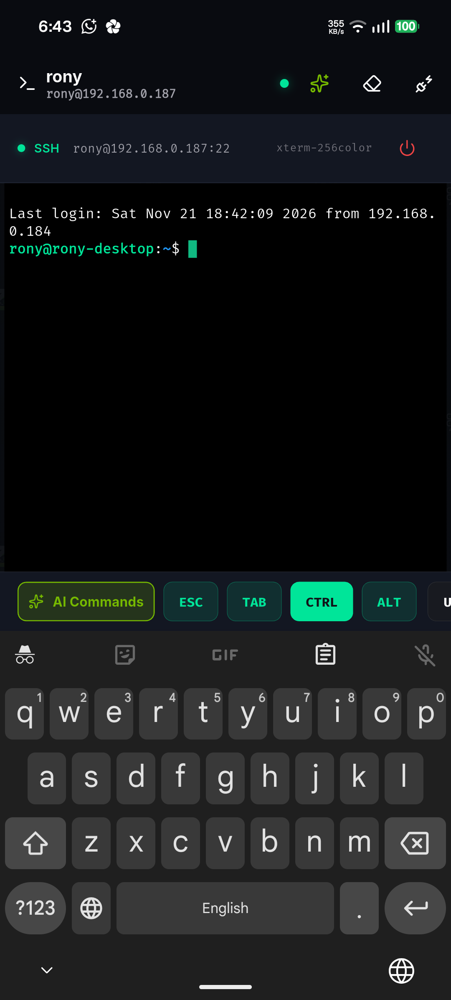
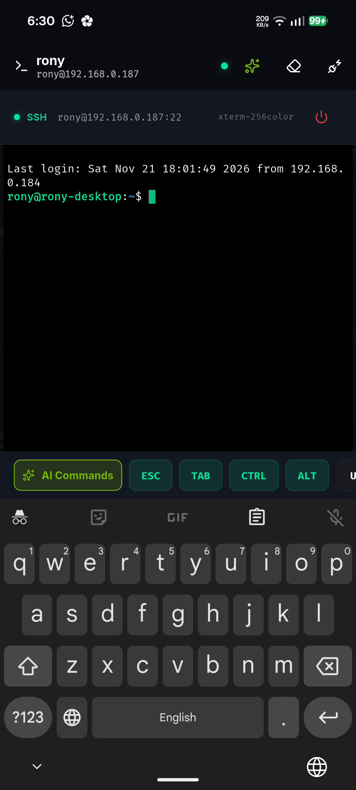
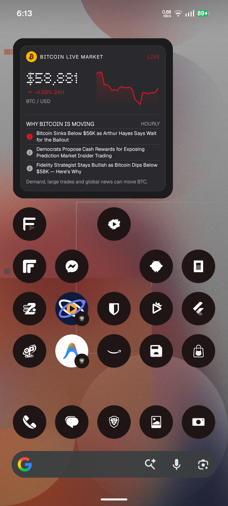
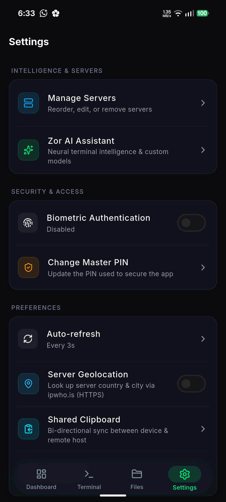

# Zor SSH

SSH Server Manager & AI Terminal for Android.

## Screenshots

| Dashboard | Terminal |
|---|---|
|  |  |

| Files | Settings |
|---|---|
|  |  |

## Features

- Real-Time Hardware Telemetry (CPU, RAM, Disks, GPU, OS Distro)
- Mobile Terminal with xterm emulation, Copy/Cut/Paste, quick keys (ESC, TAB, CTRL, ALT, ^C, ^D), and custom watermark
- AI Terminal Command Generator with destructive command safety detection
- SFTP File Manager & Transfer Manager
- Security: Hardware Master PIN (PBKDF2), Biometrics, FLAG_SECURE window protection
- Dynamic Navigation Bar with smooth scroll-hide and Material 3 design
- In-App GitHub Releases update checker
- Support the Developer via UPI (`7074018142@ptsbi`)

## Build

```bash
flutter pub get
flutter build apk --release --dart-define-from-file=secrets.json
```
