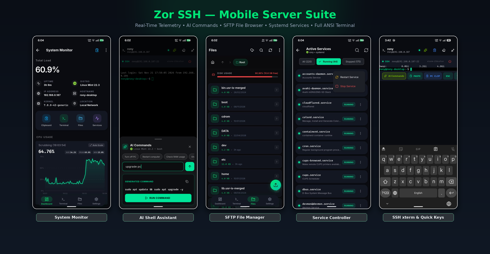
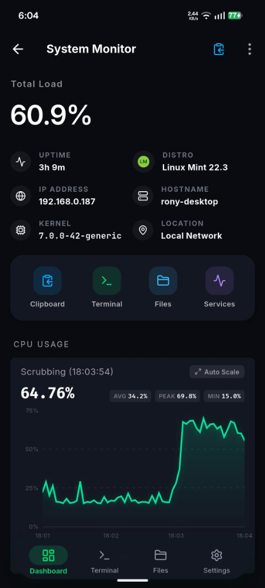
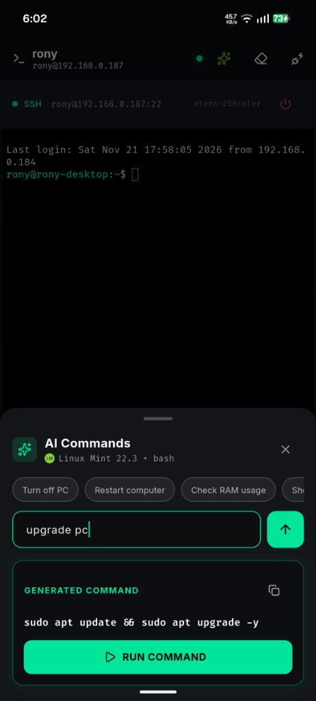
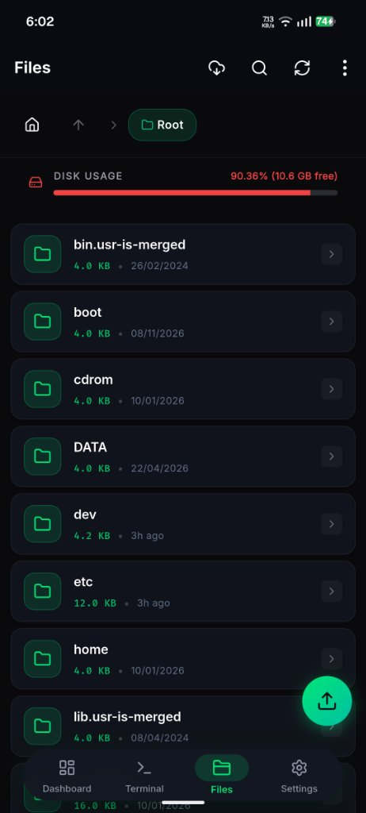
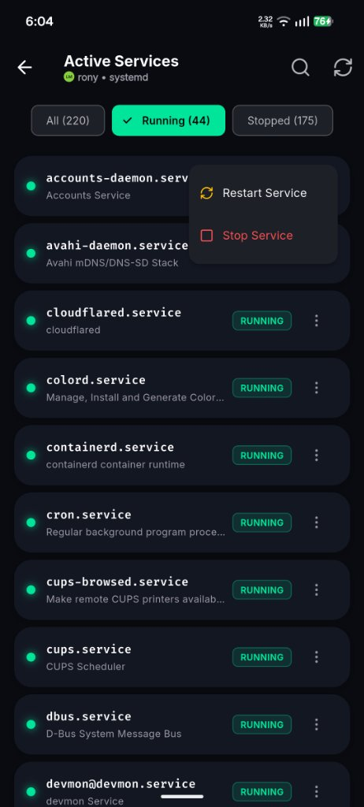
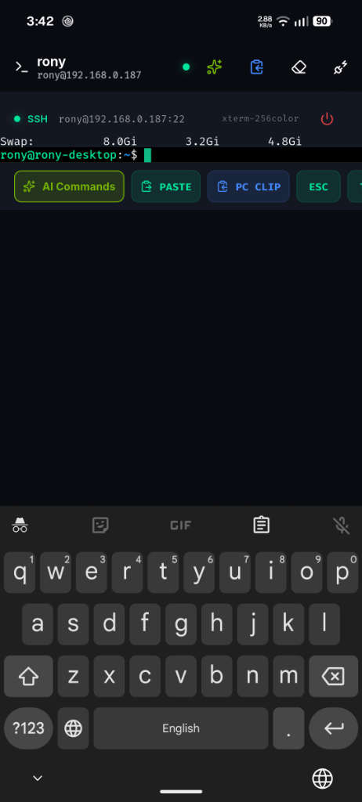

# Zor SSH

> **Next-Generation SSH Client, Server Telemetry Dashboard & AI Terminal for Android.**

<p align="center">
  
</p>

<p align="center">
  <a href="https://github.com/iamrony27/ZorSSH/releases/latest"></a>
  
  
  
  
  
</p>

---

## 📱 Visual Walkthrough & Screenshots

Zor SSH provides a cohesive, high-performance interface designed specifically for mobile system administrators and developers.

| 01. System Monitor | 02. AI Shell Assistant | 03. SFTP File Manager |
|:---:|:---:|:---:|
|  |  |  |
| Real-time CPU scrub graph, OS distro & hardware telemetry | Natural language translation into verified shell commands | Remote directory tree, disk quota gauge & file uploads |

| 04. Systemd Service Manager | 05. SSH Terminal & Quick Keys |
|:---:|:---:|
|  |  |
| Interactive service filter (Running / Stopped) with restart/stop controls | Full xterm-256color emulator with keyboard toolbar & modifier keys |

---

## 🌟 Detailed Feature Breakdown

### 1. 🖥️ Real-Time System Telemetry Dashboard
- **Live CPU Utilization Graph**: Fluid line chart with touch-scrubbing inspection (Average, Peak, Minimum, Current usage) and dynamic auto-scaling.
- **Hardware & Environment Detection**: Automatic identification of Linux distributions (Linux Mint, Ubuntu, Debian, Fedora, Arch, CentOS), kernel version (`7.0.0-42-generic`), CPU architecture, hostname, and local/public IP addresses.
- **System Load & Uptime**: Real-time total system load calculation, active session uptime, and swap memory tracking (`Swap: 8.0Gi / 3.2Gi / 4.8Gi`).
- **Quick Action Hub**: Single-tap shortcuts to open Clipboard Sync, SSH Terminal, SFTP Explorer, and Systemd Services.

### 2. 🤖 AI-Powered Shell Assistant (NVIDIA NIM)
- **Natural Language to CLI**: Convert natural language intent (e.g. *"upgrade pc"*, *"find large files over 1GB"*, *"check open ports"*) directly into distribution-accurate shell commands (`sudo apt update && sudo apt upgrade -y`).
- **Safety Inspection Engine**: Built-in AST and heuristic validator that alerts users before executing destructive operations (`rm -rf`, `mkfs`, `dd`, `shutdown`, `reboot`).
- **One-Tap Execution**: Review and execute generated commands directly in the active terminal session or copy them to the clipboard.
- **Quick Presets**: Fast shortcut chips for common administrative tasks (Turn off, Reboot, Inspect RAM, Process check).

### 3. 📂 SFTP File Explorer & Transfer Hub
- **Interactive Directory Hierarchy**: Fast navigation through remote file structures with breadcrumb paths.
- **Disk Usage Meter**: Visual storage consumption gauge showing used percentage and free gigabytes (`90.36% (10.6 GB free)`).
- **File Management**: Upload local files from Android storage, download remote files, inspect file permissions, and check file sizes.
- **Resilient SFTP Engine**: Background chunked transfers with connection retry handling.

### 4. ⚙️ Systemd Service Controller
- **Unit Status Filtering**: Instant tabbed sorting by **All (220)**, **Running (44)**, and **Stopped (175)** services.
- **Live State Badges**: Color-coded service status indicators (Running, Dead, Failed).
- **Service Lifecycle Control**: Contextual quick menu to **Restart Service** or **Stop Service** with administrative privilege execution.

### 5. ⚡ Enhanced Mobile SSH Terminal
- **xterm-256color Emulation**: High-speed terminal rendering with custom Zor SSH subtle watermark and OS distro badge.
- **Native Clipboard Integration**: Dedicated **COPY**, **CUT**, and **PASTE** buttons right above the virtual keyboard.
- **Modifier & Quick Keys Bar**:
  - Sticky modifier buttons for `CTRL` and `ALT`.
  - Direct signal keys: `^C` (SIGINT), `^D` (EOF), `^Z` (SIGTSTP).
  - Navigation keys: `ESC`, `TAB`, Arrow keys (`↑`, `↓`, `←`, `→`), `HOME`, `END`, `PGUP`, `PGDN`.
  - Frequent Unix characters: `/`, `-`, `|`, `~`.
- **Keyboard Glitch Prevention**: All toolbar buttons use non-focusable action detectors (`canRequestFocus: false`), keeping the Android virtual keyboard open without flickering or losing focus.

---

## 🛡️ Security Architecture

Zor SSH is engineered from the ground up to protect your infrastructure credentials:

- **Hardware Master PIN**: Master PIN is hashed using **PBKDF2** with **100,000 iterations** and a cryptographically secure 16-byte random salt. Plaintext PINs are never saved to storage.
- **Android Keystore Encryption**: Server passwords and private keys are encrypted using hardware-backed Android Keystore keys (AES-256-GCM).
- **Biometric Authentication**: Fingerprint and Face Unlock support with automatic fallback to Master PIN.
- **Screen Protection (`FLAG_SECURE`)**: The entire application enables Android `FLAG_SECURE`, preventing unauthorized screenshots, screen recordings, and app preview caching in the recent apps switcher.
- **Zero Plaintext Telemetry**: In-memory domain models sanitize and strip passwords and private keys during background telemetry polling.

---

## 🛠️ Building & Installation

### Prerequisites
- [Flutter SDK](https://flutter.dev) (v3.24.0 or higher)
- Android SDK (API 26 to 35)
- Java 17 / OpenJDK 17

### Build from Source

1. **Clone the repository:**
   ```bash
   git clone https://github.com/iamrony27/ZorSSH.git
   cd ZorSSH
   ```

2. **Fetch dependencies:**
   ```bash
   flutter pub get
   ```

3. **Configure API Secrets (Optional for AI assistance):**
   ```bash
   cp secrets.example.json secrets.json
   ```
   Add your NVIDIA NIM API key to `secrets.json`:
   ```json
   {
     "NVIDIA_API_KEY": "nvapi-your-key-here"
   }
   ```
   *(Note: `secrets.json` is git-ignored and never committed).*

4. **Build the production release APK:**
   ```bash
   flutter build apk --release --dart-define-from-file=secrets.json
   ```
   The compiled APK will be located at:
   `build/app/outputs/flutter-apk/app-release.apk`

---

## 🔄 In-App Updates

Zor SSH includes automatic version checking querying the official GitHub Releases API:
`https://api.github.com/repos/iamrony27/ZorSSH/releases/latest`

Whenever a new version is released, the app notifies you directly in **Settings → Check for Updates** with changelog details and single-tap APK download and installation.

---

## ☕ Support the Developer

If you find Zor SSH helpful for your workflow, you can support development via UPI:

<p align="center">
  <b>UPI ID:</b> <code>7074018142@ptsbi</code>
</p>

---

## 📄 License

This project is licensed under the [MIT License](LICENSE).
